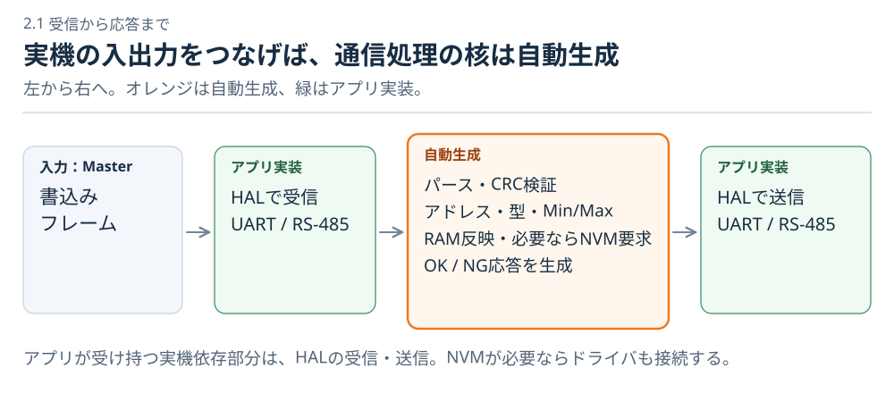
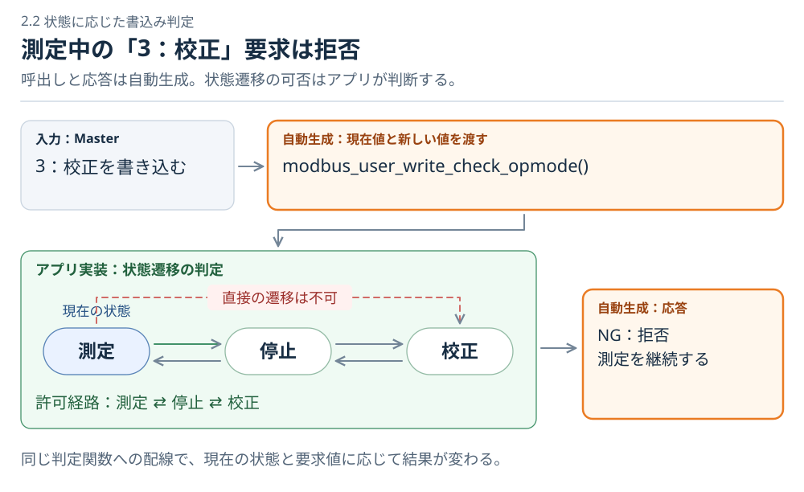
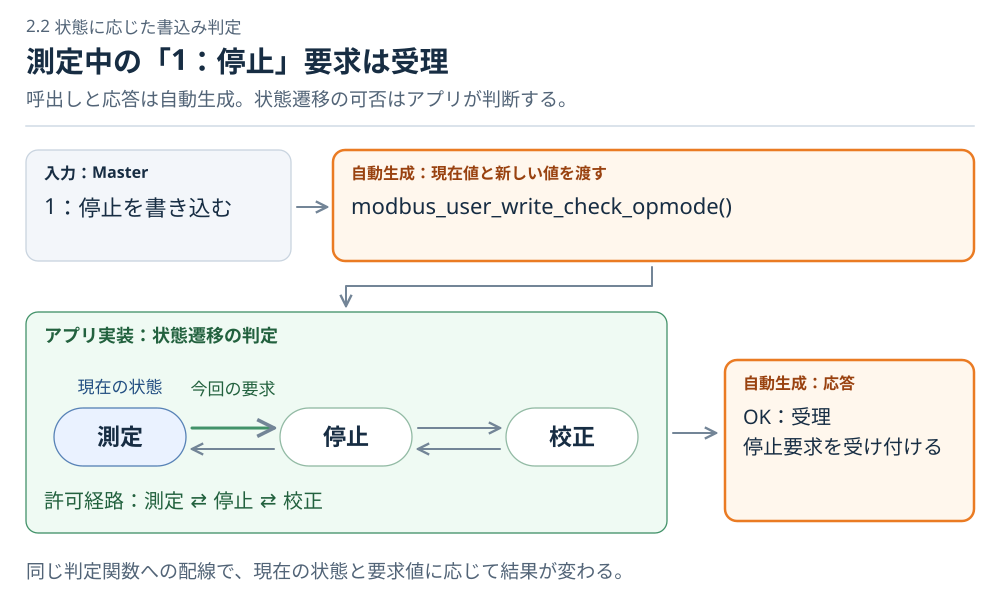
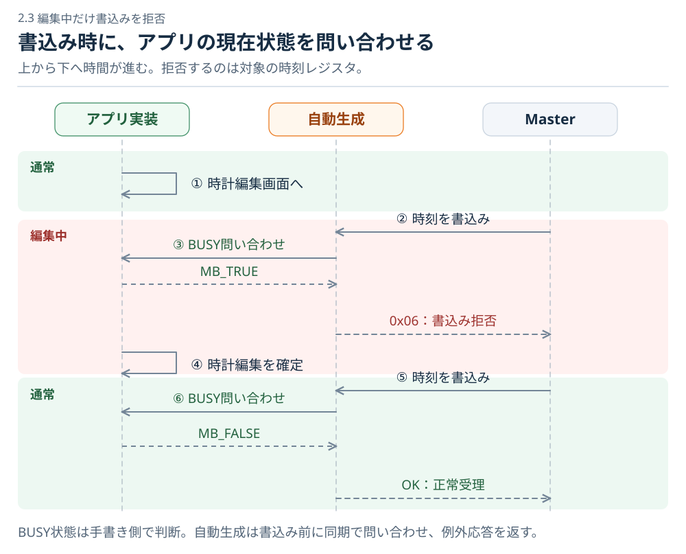
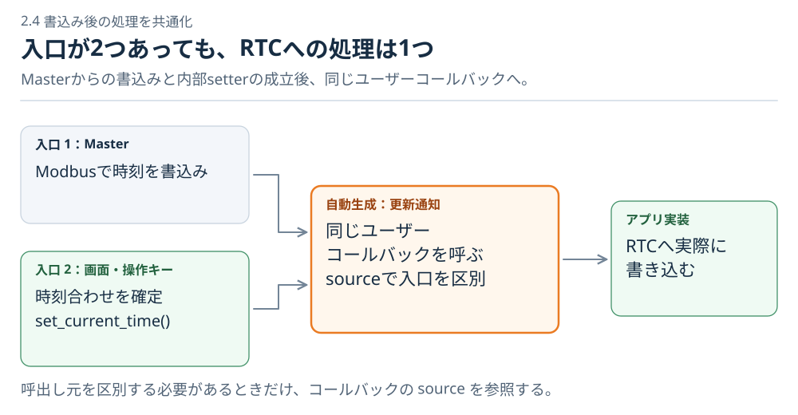
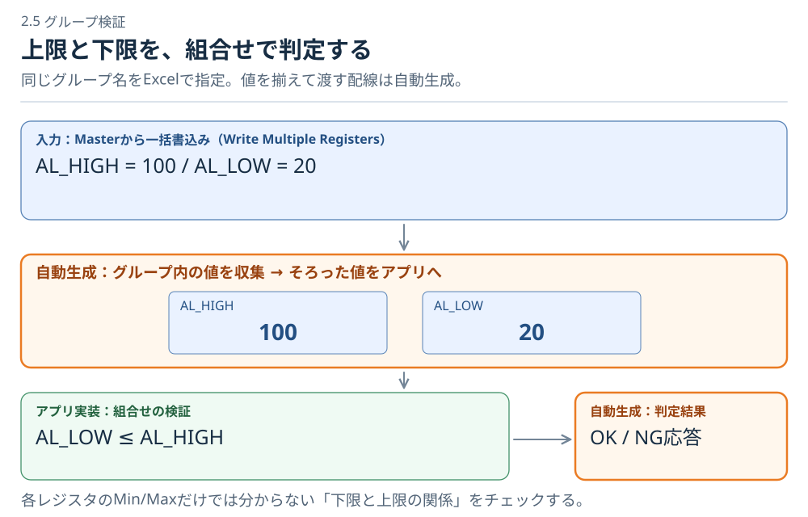
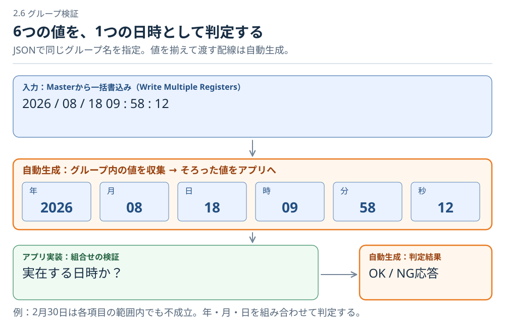
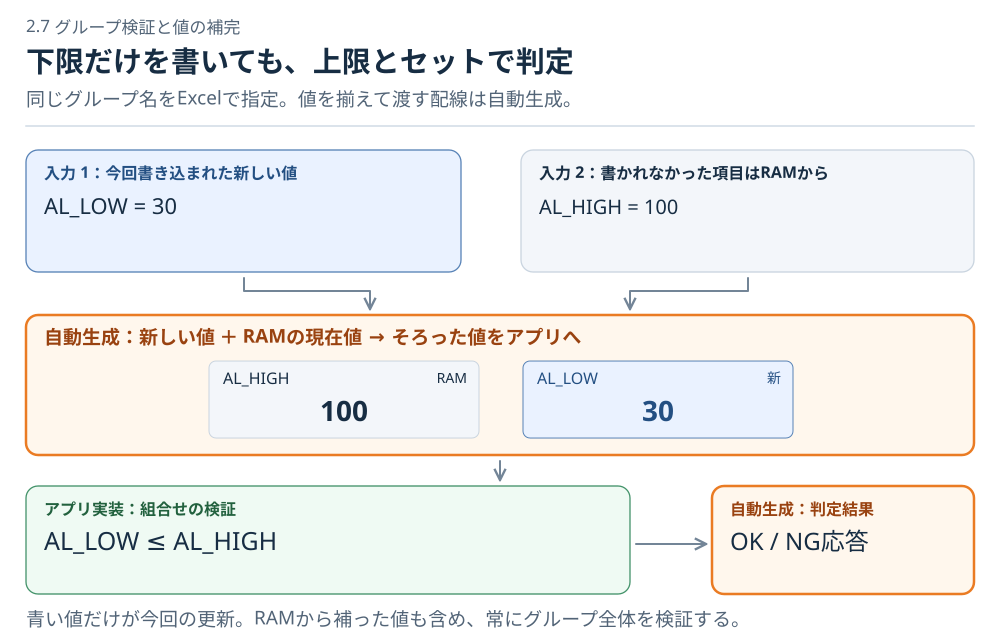
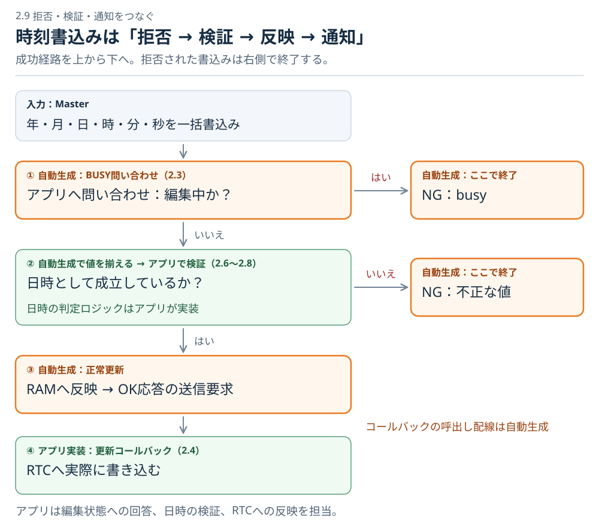

# Modbus Slave Register Map Editor

JSONでレジスタを定義し、単体HTMLからModbus slave用のC/Hを生成するツールです。レジスタ表の編集から、通信の解析・検証・現在値の管理・応答生成・更新通知までを、一つの定義からつなぎます。

## 1. なぜ作ったか

Modbusのレジスタ仕様を手でCへ写すと、番地のずれ、型や長さの取り違え、値域の不一致、応答のバイト数やCRCの誤りが入り込みます。設定を増やすたびに、getter／setterや書込み後の処理も追従させる必要があります。

このツールの目的は、**レジスタ定義を唯一の正本にすること**です。JSONを修正して再生成すれば、レジスタ表、アクセサ、通信処理、検証や通知への配線が同じ定義へ揃います。アプリケーション側は、運転状態の判断、ハードウェア操作、保存方式など、その製品で決める処理に集中できます。

### 1.1 生成コードと手書きコードの全体像

要求の受付から、書込みの検証、現在値への反映、応答、更新通知、保存用スナップショットの回収までを、一つの定義からつなぎます。次の図は、一項目の書込みを例に、自動生成する処理と手書き側の窓口をまとめたものです。


<!-- modbus-command-hover:start -->
<div id="modbus-write-command-hover"></div>
<script id="modbus-write-command-hover-script">
(() => {
  const host = document.getElementById('modbus-write-command-hover');
  const image = host.previousElementSibling.querySelector('img');
  if (!image || !image.src.startsWith('data:image/svg+xml;base64,')) return;
  const bytes = Uint8Array.from(atob(image.src.split(',')[1]), c => c.charCodeAt(0));
  const parsed = new DOMParser().parseFromString(new TextDecoder().decode(bytes), 'image/svg+xml');
  if (parsed.querySelector('parsererror')) return;
  const svg = document.importNode(parsed.documentElement, true);
  host.appendChild(svg);
  image.parentElement.hidden = true;
  const buttons = [...svg.querySelectorAll('button.gate-hotspot')];
  const popups = [...svg.querySelectorAll('.command-popup')];
  const show = key => {
    popups.forEach(popup => {
      const open = popup.dataset.key === key;
      popup.classList.toggle('is-open', open);
      popup.setAttribute('aria-hidden', String(!open));
    });
  };
  buttons.forEach(button => {
    const key = button.dataset.key;
    button.addEventListener('pointerenter', () => show(key));
    button.addEventListener('pointerleave', () => show(null));
    button.addEventListener('focus', () => show(key));
    button.addEventListener('blur', () => show(null));
  });
  document.addEventListener('keydown', event => { if (event.key === 'Escape') show(null); });
})();
</script>
<!-- modbus-command-hover:end -->

GitHubのREADMEでは通常のSVG画像として全体像を表示します。変換したHTMLでは、ひし形にマウスを乗せると、その判定が参照する要求要素を表示します。キーボードでフォーカスした場合も表示し、離れると消えます。

UART受信割込み・Appループ・キューやフラグ・永続化処理は組込み例です。BUSY・単項目検証・組合せ検証・更新通知は、定義で設定した対象へ適用します。保存経路は、変更がありスナップショットを回収できた場合を描いています。

### 1.2 自動生成と手書きの責務

| 領域 | 自動生成すること | 手書き側で決めること |
|---|---|---|
| 通信 | 受信済みRTUフレームの解析、CRC検査、正常／例外応答の組立て | 受信ドライバ、フレーム完成の判定、送信キュー、物理送信 |
| 宛先 | 要求ごとに受付可否を問い合わせる | 固定番地、設定値、複数宛先などの受付条件 |
| 値 | 型・値域・enum・文字列の検査、レジスタの現在値、名前付きアクセサ | 測定値をいつ更新するか、設定値をどう利用するか |
| 書込みの採否 | BUSY・単項目・グループ検証の呼出しと例外応答 | 編集中かどうか、状態遷移や項目の組合せが妥当か |
| 更新後の処理 | 正常な書込み／setterから同期コールバックを呼ぶ | RTC反映、動作要求、後続処理のフラグやキュー |
| 永続化 | 保存要通知、保存用スナップショットの回収、復元時の値検査 | 保存媒体、物理番地、保存方式、完了・失敗・再試行 |

生成コードは、呼び出した側の実行文脈で動きます。受信割込みからバッファへ蓄え、Appループからparserを呼ぶ構成は組込み例の一つです。実行機会の分離や排他は利用側で設計します。

## 2. 利用シナリオ

ここでは、JSON定義から生成できる代表的な利用シナリオを紹介します。図のオレンジは自動生成、緑はアプリ実装を表します。レジスタ名や設定値は各シナリオの説明用です。

### 2.1 定型的な通信処理を代行する

Masterから書込み要求を受信した場合、実機の処理は次の流れになります。

1. 手書き側がUARTなどで受信し、完成したRTUフレームを渡す。
2. 生成parserが宛先・CRC・機能・番地・権限・値を確認する。
3. 書込み全体の検証に成功したら、レジスタの現在値へ反映する。
4. 正常応答、または拒否理由に応じた例外応答を組み立てる。
5. 手書きの送信口へフレームを渡す。



バイト列と定義の照合は生成側、物理的な受信・送信は手書き側の責務です。保存対象の値が変化すると保存要通知が立ち、利用側が後からスナップショットを回収できます。

### 2.2 「通してよいか」をアプリに問い合わせる

運転要求を、1＝停止、2＝測定、3＝校正とします。測定から校正への直接遷移を拒否し、測定から停止への遷移を受け付けたい場合、値域の検査に加えて現在の運転状態を見る必要があります。

レジスタの詳細で`writeCheck`を有効にすると、生成parserが現在値と候補値を`modbus_user_write_check_<name>()`へ渡します。手書き側は遷移の可否を返し、生成側がRAM反映と正常／例外応答を担当します。





### 2.3 編集中の項目への書込みを拒否する

画面で時刻を編集中は、通信側から同じ時刻を上書きされたくないことがあります。`busyReject`を有効にすると、生成parserが書込み要求ごとに`modbus_user_is_busy_<name>()`を同期で呼びます。

手書き側は現在の画面や動作状態を見て、受付可能なら`MB_FALSE`、BUSYなら`MB_TRUE`を返します。生成側はBUSYを例外`0x06`として返します。編集状態は手書き側が持ち、問い合わせのたびに回答します。



BUSYは受付時点の状態、`writeCheck`は現在値と候補値を含めた内容の妥当性、という役割分担です。

### 2.4 通信と画面操作から同じ後続処理へつなぐ

時刻が書き込まれたら、RTCにも反映したいとします。通信からの書込みと、画面操作からの生成setterの両方を同じ処理へつなぐには、`updateNotify`を有効にします。

生成側が`modbus_user_<name>_updated(source)`を呼びます。`source`でMaster writeと内部setterを区別でき、同じ値を設定した場合も正常な操作として通知します。



図のRTC処理は後続処理の役割を示します。実機では、コールバックで処理待ちフラグを立て、AppループからRTC操作を進める構成にもできます。

### 2.5 上限と下限をまとめて検証する

警報下限`AL_LOW`と警報上限`AL_HIGH`は、それぞれが範囲内でも、組合せとして`AL_LOW <= AL_HIGH`である必要があります。

両方の`groupValidate`に同じグループ名を指定すると、生成側が書込み後の候補値を専用構造体へ揃え、`modbus_user_group_validate_<group>()`へ渡します。手書き側は値同士の関係を判定します。



### 2.6 複数項目を一つの日時として検証する

年・月・日・時・分・秒を同じ`groupValidate`へ所属させると、6項目を揃えて検証できます。たとえば2月30日は、月と日それぞれの値域に入っていても、実在する日時として拒否できます。



### 2.7 一部だけ書かれても、現在値で補完する

`AL_HIGH=100`、`AL_LOW=20`のとき、Masterが下限だけを30へ更新するとします。グループ検証へは、新しい下限30と、現在の上限100を組み合わせて渡します。

手書き側は、今回どちらが書かれたかに関係なく、揃った値で同じ検証を行えます。



### 2.8 日時の一部だけを書いた場合も補完する

「分」だけを42へ更新する要求でも、年・月・日・時・秒は現在値から補完します。検査関数は、反映予定の日時全体を一つの専用構造体として受け取ります。


### 2.9 拒否・検証・反映・通知を組み合わせる

時刻書込みなら、編集状態へのBUSY問い合わせ、各項目の値域検査、日時全体の検証、RAM反映、正常応答の送信依頼、更新通知という順序になります。



手書き側は、編集状態への回答、日時の妥当性判定、RTCへの反映を担当します。正常応答の送信依頼後に更新コールバックへ進むため、UART設定変更や再起動などは、利用側で物理送信の完了を確認してから実行します。

## 3. 対象とする環境

| 項目 | 内容 |
|---|---|
| エディター | [modbus-regmap-editor.html](modbus-regmap-editor.html)をChromeまたはEdgeで開く |
| 入力 | JSONのレジスタ定義。単体HTMLへ編集中データを保存することも可能 |
| 出力 | C89相当のC/H一式をZIPで保存 |
| 組込み先 | `stdint.h`、生成コードが想定する整数型・32ビットfloat表現を扱えるC環境 |
| 開発環境 | エディター自体を改訂する場合はNode.jsとnpmを使用 |

生成する通信処理は、CRC付きのModbus RTUフレームを扱います。RS-485のDE／RE制御、UART割込み、RTUの無通信時間によるフレーム区切りなどは、利用側が接続します。

## 4. 使い方

### 4.1 定義の編集と保存

1. [modbus-regmap-editor.html](modbus-regmap-editor.html)をChromeまたはEdgeで開きます。
2. 「JSONを開く」から製品の定義を読み込みます。起動時のサンプルは操作確認に使えます。
3. 基本設定でスレーブアドレスとNVMサイズを確認し、必要なら配列長定義・部分初期化グループを編集します。
4. 「レジスタ」タブで番地、変数名、型、配列長、アクセス属性、値域、Default、NVMオフセットを編集します。
5. 各行の「詳細」で書込み検証・更新通知・BUSY・グループ検証・部分初期化の所属と説明を設定します。enumやビット定義は専用タブで定義し、レジスタへ割り当てます。
6. 入力チェックを確認し、「JSONを保存」で定義を保存します。
7. 「C/H 一括生成」で生成内容を確認し、ZIPを保存します。

「HTMLに上書き保存」またはCtrl+Sでは、編集中データを含むHTMLを保存できます。初回に保存先を選ぶと、同じタブでは以後同じファイルへ上書きできます。そのHTMLを開くと保存した状態から再開できます。

JSONは定義を持ち運ぶための正本、データを含むHTMLはエディターごと編集状態を持ち運ぶ方法として使えます。配布HTMLを更新するときも、製品JSONを保存してから読み込み直せます。

### 4.2 入力チェックと再生成

Modbus番地の占有範囲、NVMの占有範囲、名前の重複、Defaultと値域、参照先のenum・ビット定義・初期化グループなどを検査します。数値は10進数、番地やオフセットなどの整数欄は`0x`始まりの16進数も使用できます。

エラーを解消してから一式を再生成し、製品側の生成ファイルを揃えて更新します。手書きのコールバックは別ファイルに置くと、生成物を交換しながらアプリケーションの処理を維持できます。

## 5. 生成コードの組込み方

### 5.1 全体の流れ

1. 生成されたCをコンパイル対象へ、Hをインクルード対象へ追加する。
2. 送信口と宛先の受付関数を実装する。
3. 定義で有効にしたBUSY・検証・更新通知のコールバックを実装する。
4. 起動時にDefaultを設定し、有効な保存データがあれば復元する。
5. 受信完了フレームを`modbus_parse_and_reply()`へ渡す。
6. 内部の値操作は公開getter／setterを使う。
7. 永続化を使う場合は、保存要通知をポーリングしてスナップショットを回収・保存する。

以下の`product_*`は手書き側の役割を示す仮の関数名です。実際のドライバやサービスへ置き換えてください。

### 5.2 送信口と宛先を接続する

`modbus_parser.h`の宣言に合わせて、次の2関数を実装します。

```c
#include "modbus_parser.h"

void ModbusPort_RequestSend(const uint8_t *frame, uint16_t length)
{
    product_tx_enqueue_copy(frame, length);
}

uint8_t modbus_user_accept_slave_address(uint8_t address)
{
    return address == product_current_slave_address() ? 1U : 0U;
}
```

`frame`はCRCを含めて組立て済みです。送信をキューやDMAへ委ねる場合は、この関数から戻るまでに利用側の送信用領域へコピーするか、送信を完了させます。生成側のバッファの寿命は呼出し中として扱います。送信受付、キュー容量、RS-485方向制御、送信完了の管理は利用側が担当します。

宛先の受付は要求ごとに問い合わせます。固定値にも、レジスタの設定値にも、複数の受付番地にも対応できます。基本設定のアドレスから`MODBUS_SLAVE_ADDR`も生成しますが、parserの採否はこの関数の戻り値で決まります。

#### BUSY・単項目検証を接続する

`device_mode`に`busyReject`と`writeCheck`を設定した例です。画面の編集中はBUSY、測定（2）から校正（3）への直接遷移は不正な値として拒否します。

```c
#include "modbus_reg_write_guard_slave.h"

MB_BOOL modbus_user_is_busy_device_mode(void)
{
    return product_is_mode_editing() != 0 ? MB_TRUE : MB_FALSE;
}

modbus_write_result_t modbus_user_write_check_device_mode(
    uint16_t current_value, uint16_t new_value)
{
    if ((current_value == 2U) && (new_value == 3U))
    {
        return MODBUS_WRITE_ILLEGAL_VALUE;
    }
    return MODBUS_WRITE_OK;
}
```

有効にしたコールバックの宣言は生成ヘッダーに並びます。手書き側は、それぞれの宣言と同じ型・名前で実装します。

### 5.3 起動時のDefaultと保存データの復元

`modbus_reg_load_defaults()`で全項目へDefaultを設定してから、保存データを`modbus_reg_nvm_restore()`へ渡します。保存対象だけが復元され、RAM専用項目はDefaultを保持します。

```c
#include "modbus_reg_map_slave.h"
#include "modbus_reg_nvm_slave.h"

static uint8_t s_boot_data[NVM_TOTAL_SIZE];

void product_prepare_registers(void)
{
    modbus_nvm_restore_result_t result;

    modbus_reg_load_defaults();
    if (product_read_saved_settings(s_boot_data, sizeof(s_boot_data)) != 0)
    {
        result = modbus_reg_nvm_restore(s_boot_data, sizeof(s_boot_data));
        product_report_restore_result(result);
    }
    else
    {
        modbus_reg_nvm_mark_dirty();
    }
}
```

この例は、保存データを取得できなければDefaultを保存対象にする方針です。有効な保存データの判定や読出しエラー時の扱いは、利用側で決めます。`load_defaults()`は起動準備用で、保存要通知を立てません。選択範囲を初期化して保存したい場合は、部分初期化APIを使います。

復元APIは、保存対象の値を型・値域・文字列・enumに従って検査します。不正な項目だけをDefaultへ補修し、ほかの正常な項目は復元します。補修時は`MODBUS_NVM_RESTORE_REPAIRED`を返し、保存要通知を立てます。ログや製品のエラー表示は利用側が行います。

### 5.4 受信済みのフレームを渡す

```c
void product_handle_received_frame(const uint8_t *frame, uint16_t length)
{
    modbus_parse_and_reply(frame, length);
}
```

渡すのは宛先からCRCまでを含む一つのRTUフレームです。parserはNULL、8バイト未満、256バイト超の入力を無応答で終了します。宛先の受付後、CRCと機能ごとの要求を検査し、応答が必要な場合は送信口を呼びます。

対応機能は`0x03`（Holding Registers読出し）、`0x06`（単一レジスタ書込み）、`0x08`のサブ機能0（診断エコー）、`0x10`（複数レジスタ書込み）です。製品固有の機能は、手書きの前段で振り分ける構成にできます。

parser・setter・スナップショット回収は、一つの実行文脈から直列に呼ぶ構成を基本とします。受信割込みとAppループを分ける場合は、利用側で受信バッファを介して受け渡します。

### 5.5 getter／setterで値を使う

数値スカラーの例です。以下は`device_mode`を`uint16_t`、`process_value`を`float`で定義した場合です。

```c
uint16_t mode;
float value;

mode = get_device_mode();
value = get_process_value();
if (set_device_mode(2U) == 0)
{
    product_report_invalid_setting();
}
```

数値setterの成功は1、失敗は0です。通常の数値項目には`get_<name>_min()`、`get_<name>_max()`、`get_<name>_default()`も生成します。数値配列のgetter／setterはindexを受け取り、Default取得もindexを指定します。

enumのアクセサは型付きです。起動時サンプルのパリティなら、次の形で使えます。

```c
modbus_parity_t parity;

if (get_ModbusParityBit(&parity) != 0)
{
    product_apply_parity(parity);
}
(void)set_ModbusParityBit(MODBUS_PARITY_NONE);
```

内部setterは、通信側の書込み属性とは別に、アプリケーションから現在値を更新する窓口です。通信要求用のBUSY・`writeCheck`・`groupValidate`はparserの検査経路へ適用されます。内部更新時の業務上の採否は、呼出し元で判断します。

### 5.6 更新通知から後続処理へつなぐ

`updateNotify`を有効にした全項目について、`modbus_user_<name>_updated()`を実装します。次は通知対象を`device_mode`とした例です。

```c
#include "modbus_reg_update_notify_slave.h"

static uint8_t s_mode_update_pending;

void modbus_user_device_mode_updated(modbus_reg_update_source_t source)
{
    (void)source;
    s_mode_update_pending = 1U;
}
```

`source`は`MODBUS_REG_UPDATE_SOURCE_MASTER_WRITE`または`MODBUS_REG_UPDATE_SOURCE_INTERNAL_SET`です。通信書込みでは、全対象のRAM反映、正常ACKの送信依頼、項目別の更新通知の順に進みます。複数項目の通知はアドレス昇順です。内部setterでは、正常な更新操作の後、setterが戻る前に通知します。

これは値変化だけの通知ではなく、正常な更新操作の成立通知です。同値write／setでも通知します。保存要通知は保存対象の値変化を扱うため、更新コールバックとは目的が異なります。

通知はparser／setterの呼出し元で同期実行します。時間のかかる処理は、上の例のようにフラグやキューへ渡して進められます。同じ項目のsetterをその通知内で再び呼ぶと再通知へ入るため、循環しない呼出し関係にします。通信設定変更や再起動は、物理送信の完了条件も利用側で管理します。

### 5.7 保存用スナップショットを回収する

`modbus_reg_nvm_slave.h/.c`に以下を生成します。

| API | 動作 |
|---|---|
| `modbus_reg_load_defaults()` | 起動準備として全RAMへDefaultを設定する |
| `modbus_reg_reset_defaults(group)` | 選択グループを初期化し、保存要通知を立てる |
| `modbus_reg_nvm_mark_dirty()` | 明示的に保存要通知を立てる |
| `modbus_reg_nvm_capture_if_changed(dst, capacity)` | 保存対象を同期コピーし、成功時に今回分の通知を消費する |
| `modbus_reg_nvm_restore(src, size)` | 保存データ全体を同期検査・復元し、不正項目をDefaultへ補修する |

呼出し元が`NVM_TOTAL_SIZE`バイト以上のスナップショット領域を持ちます。回収では未使用位置を0xFFで埋め、定義されたNVMオフセットへ各保存対象を配置します。復元は正確な全体サイズを要求し、型・範囲・文字列・列挙値を検査します。補修時は保存要通知が立ちます。

スナップショット領域の確保と保持、不揮発ストレージへの保存、受付・完了・失敗の扱いは製品側が担当します。生成器は同期的なRAMと保存データの受渡し、および変更通知を担当します。これらのAPIは、複合RAM更新の外側で、同じ実行コンテキストから呼びます。

保存処理の一例です。`product_save_is_busy()`は前回の保存中を返し、`product_request_save()`は受け付けた時点で保存中へ移るものとします。

```c
static uint8_t s_save_snapshot[NVM_TOTAL_SIZE];

void product_save_poll(void)
{
    modbus_nvm_capture_result_t result;

    if (product_save_is_busy() != 0)
    {
        return;
    }
    result = modbus_reg_nvm_capture_if_changed(
        s_save_snapshot, sizeof(s_save_snapshot));
    if (result == MODBUS_NVM_CAPTURE_CAPTURED)
    {
        if (product_request_save(s_save_snapshot,
                                 sizeof(s_save_snapshot)) == 0)
        {
            modbus_reg_nvm_mark_dirty();
        }
    }
}
```

回収は呼出し中に完了し、成功したときだけ今回分の保存要通知を消費します。保存中は回収先を固定して保持します。その間にレジスタの現在値が変わると、新しい保存要通知が次回の回収へ残ります。物理的な保存は非同期でも構いません。

この例では保存依頼を受け付けられなかった場合に通知を立て直します。受け付けた後の保存失敗、再試行回数、保存媒体や保存方式は利用側が決めます。保存形式の識別・変換・初期化方針も、製品側で設計します。

## 6. 定義と生成仕様

### 6.1 JSONの構成とレジスタ表

定義JSONは`format: "modbus-slave-regmap"`、`schemaVersion: 5`です。トップレベルに`config`、`lengthDefs`、`enums`、`bitsetDefs`、`resetGroupDefs`、`registers`を保存します。

| 要素 | 役割 |
|---|---|
| `config.slaveAddress` | 1〜247。生成する`MODBUS_SLAVE_ADDR`の値。実際の宛先受付は手書き関数で判断 |
| `config.nvmSize` | 1〜65535バイト。生成する`NVM_TOTAL_SIZE`の値 |
| `lengthDefs` | `{name, length}`で配列長の名前と値を定義 |
| `enums` | 複数のレジスタから参照できるenum定義 |
| `bitsetDefs` | 16／32ビットの名前付きビット定義 |
| `resetGroupDefs` | 部分初期化のグループ定義 |
| `registers` | 番地ごとの定義、値の指定、検証・通知・初期化所属 |

各レジスタの主な要素は次のとおりです。

| 要素 | 例 | 意味 |
|---|---|---|
| `address` | `1000` | 0〜65535のModbus開始番地 |
| `name` | `device_mode` | C識別子・アクセサ名・コールバック名の基になる名前 |
| `type` | `uint16_t` | `uint16_t`／`uint32_t`／`float`／`string`／`reserved` |
| `length` | `1`、`"NAME_LEN"` | 要素数、文字列の固定長バイト数、予約レジスタ数。通常項目は配列長定義も参照可能 |
| `access` | `"RW"` | 通信側の`RO`／`RW`／`WO`。予約領域は`"-"` |
| `valueDomain` | `{kind: "range", min: 0, max: 3, default: 1}` | 数値範囲、enum、ビット、文字列、予約の指定 |
| `nvmOffset` | `16`、`"-"` | 保存データ先頭からのバイトオフセット。`"-"`はRAM専用 |
| `updateNotify` | `true` | 正常な通信write／内部setterの成立通知 |
| `busyReject` | `true` | 通信writeの前に手書きのBUSY状態へ問い合わせる |
| `writeCheck` | `true` | 通信writeの現在値と候補値を手書き検査へ渡す |
| `groupValidate` | `"alarms"`、`"-"` | 書込み予定値を揃えて検証するグループ名 |
| `resetGroups` | `["settings"]` | 部分初期化の所属。複数指定可能 |
| `unit`／`summary`／`description`／`spec`／`notes` | 説明文字列 | 人間向けの単位、概要、詳細、仕様、備考 |

値域を持つ数値項目のJSON例です。この1件だけでも定義として読み込めます。

```json
{
  "format": "modbus-slave-regmap",
  "schemaVersion": 5,
  "config": {"slaveAddress": 1, "nvmSize": 256},
  "lengthDefs": [],
  "enums": [],
  "bitsetDefs": [],
  "resetGroupDefs": [{"id": "settings", "label": "設定"}],
  "registers": [{
    "address": 1000,
    "name": "device_mode",
    "type": "uint16_t",
    "length": 1,
    "access": "RW",
    "valueDomain": {"kind": "range", "min": 0, "max": 3, "default": 1},
    "nvmOffset": 0,
    "updateNotify": true,
    "busyReject": true,
    "writeCheck": true,
    "groupValidate": "-",
    "resetGroups": ["settings"],
    "unit": "-",
    "summary": "運転要求",
    "description": "-",
    "spec": "-",
    "notes": "-"
  }]
}
```

### 6.2 型・配列・文字列・予約領域

| 型 | 1要素のRAM／保存サイズ | Modbusの占有範囲 |
|---|---|---|
| `uint16_t` | 2バイト | 1レジスタ |
| `uint32_t` | 4バイト | 2レジスタ |
| `float` | 4バイト | 2レジスタ |
| `string` | `length`バイト | `length / 2`レジスタ |
| `reserved` | 実値のRAMを持たない | `length`レジスタ |

数値配列は要素数分を連続配置します。たとえば番地100に長さ3の`uint32_t`を置くと、100〜105を占有します。通信値は上位バイトから送受信し、32ビット値も上位側から配置します。保存データは生成コードのメモリー表現をコピーするため、通信フレームとは区別して扱います。

#### 6.2.1 文字列は固定長フィールド

文字列の`length`は2以上の偶数で、RAM・保存データ・通信上の固定長バイト数です。ASCII printable文字を最大`length`文字まで格納できます。短い文字列の残りは0で埋め、最大長なら全バイトを文字として使います。JSONの初期値は`valueDomain: {kind: "string", default: "SENSOR-A"}`、空文字列は`default: ""`です。

手書き側へ取得するときは、終端NULを追加するコピーAPIを使います。次は`device_name`を文字列として定義した例です。

```c
char name_copy[MODBUS_device_name_BUFFER_SIZE];

if (get_device_name_copy(name_copy, sizeof(name_copy)) != 0)
{
    product_show_name(name_copy);
}
(void)set_device_name("SENSOR-A");
```

`MODBUS_<name>_MAX_LENGTH`は固定長、`MODBUS_<name>_BUFFER_SIZE`は固定長＋終端NULのサイズです。通信では1レジスタへ2バイトずつ格納します。通信書込みと復元でも、文字と末尾の0埋めの整合性を検査します。

#### 6.2.2 予約領域

`reserved`は、連続読出しに含めたい空き番地を定義します。読出しでは0を返し、RAM・保存領域・アクセサを持ちません。予約領域を含む通信書込みは例外`0x02`になります。予約領域の`length`はレジスタ数で指定します。

#### 6.2.3 番地と保存オフセット

Modbus番地は16ビットレジスタ単位、`nvmOffset`はバイト単位です。数値を同じ値に揃える必要はありません。保存領域は`config.nvmSize`内へ収め、ほかの保存対象と重複しないよう配置します。エディターは重複・範囲超過をエラー、型サイズ境界に揃っていない保存オフセットを警告として扱います。

通信は各定義項目の全体を扱います。複数項目をまとめた要求も扱えますが、32ビット値や配列など一項目の途中から開始したり、途中で終えたりする範囲は拒否します。

### 6.3 列挙型・書込み検証・更新通知

列挙型は「列挙型」タブで登録し、配列長1の`uint16_t`レジスタの詳細から指定します。JSONの`enums`へ選択肢を登録し、各レジスタの`valueDomain`から型と初期値を参照します。通信・保存には登録した`uint16_t`の値を使います。

列挙型のgetterは出力引数、setterは値引数で列挙型を受け取り、成功時に1、失敗時に0を返します。

`busyReject`を有効にした項目は、`modbus_reg_write_guard_slave.h`へ宣言する同期callback `MB_BOOL modbus_user_is_busy_<name>(void);`を製品側で実装します。書込み要求ごとに手書き側の現在状態を問い合わせ、`MB_FALSE`なら続行、それ以外なら例外`0x06`を返します。要求に含まれる全対象のBUSY確認に成功してから、値の検証とRAM反映へ進みます。BUSY状態の所有者は手書き側です。

`writeCheck`でアプリの検証関数へ現在値と要求値を渡し、`groupValidate`で複数項目をまとめて検証できます。書込み全体の検証に成功してからRAMへ反映します。

`updateNotify`を有効にすると、正常なMaster writeと内部setterから同期コールバックを呼びます。同じ値の設定も正常な操作として通知します。NVMの保存要通知は、保存対象の値が変化した場合に立ちます。

### 6.4 ビット定義

「ビット定義」タブで定義ID・表示名・16/32ビット幅と各ビットの番号・識別名・表示名を登録します。maskは番号から表示します。レジスタの詳細で値の指定を「ビット定義」にし、定義と初期値を選択します。初期値のチェックとhex入力は連動し、未定義ビットもhexから指定できます。

JSONは`bitsetDefs: [{id, label, width, bits: [{bit, id, label}]}]`と、各レジスタの`valueDomain: {kind: "bitset", bitsetId, default}`で表します。配列長1の`uint16_t`／`uint32_t`へ同じ幅の定義を割り当てます。通信・RAM・NVMでは、指定した幅の整数として全ビットを扱います。

`modbus_reg_bits_slave.h`へ共通の`modbus_bit_state_t`（`MODBUS_BIT_OFF`／`MODBUS_BIT_ON`）、`<定義ID>_bits_t`構造体と`<定義ID>_<識別名>_MASK`の大文字定数を生成します。構造体の各フィールドは`modbus_bit_state_t`です。実装とAPI宣言は`modbus_reg_access_slave.c/.h`に置きます。

| API | 動作 |
|---|---|
| `get_<reg>_<bitid>()` | 1ビットをOFF／ONで取得する |
| `set_<reg>_<bitid>(on)` | OFF／ONを検査し、1ビットを反映する |
| `get_<reg>_bits()` | 定義された全ビットを構造体で取得する |
| `set_<reg>_bits(bits)` | 値渡しされた全フィールドを検査し、定義済みビットを1回で反映する |
| `clear_<reg>_all()` | 予約ビットを含む整数全体を0にする |

個別setterと`set_bits`は予約ビットを維持します。成功は1、失敗は0です。更新通知対象では成功時に1回通知し、同値設定も通知します。生整数のgetter・Default取得APIと、上表の専用ビット操作APIを公開します。未定義のrawビットも通信・NVMで受け付けます。

`tools/test-editor-bitsets.cjs`はJSONの保存・読込み、不正定義の拒否、幅の境界、UIのチェック／hex連動、HTMLへの編集データ保存・読込みを確認します。生成C本体のビット処理をJavaScriptへ適応実行し、RAM/NVM反映と通知の境界をモックして予約ビット維持、検査後の一括反映、bit 31、同値・失敗時の通知も確認します。C構文確認・静的解析とファームウェアの実行確認は別に扱います。

### 6.5 部分初期化グループ

`resetGroupDefs`でグループを定義し、レジスタごとの`resetGroups`から参照します。HTMLでは「部分初期化グループ」で定義を編集し、各レジスタの「詳細」画面にある「部分初期化」のチェックで所属を指定します。

部分初期化の定義例です。グループ定義と、レジスタの所属指定を抜粋しています。

```json
{
  "resetGroupDefs": [
    {"id": "mc_parameters", "label": "MC PARAMETERS"},
    {"id": "mc_all", "label": "MC ALL"}
  ],
  "registers": [
    {"resetGroups": ["mc_parameters", "mc_all"]}
  ]
}
```

1つの項目を複数グループへ所属させられます。グループ間の包含関係は、各項目の所属で明示します。RO・RAM専用項目も対象にでき、予約領域の所属や未定義・重複参照は入力エラーになります。

公開enumは`modbus_reset_group_t`で、定数名は`MODBUS_RESET_GROUP_<グループIDの大文字>`です。成功した部分初期化は、値が同じ場合も必ず保存要通知を立てます。

### 6.6 検証関数の戻り値とコピー

`writeCheck`と`groupValidate`は、次の`modbus_write_result_t`を返します。

| 値 | 意味 |
|---|---|
| `MODBUS_WRITE_OK` | 受理 |
| `MODBUS_WRITE_ILLEGAL_ADDRESS` | 例外`0x02` |
| `MODBUS_WRITE_ILLEGAL_VALUE` | 例外`0x03` |
| `MODBUS_WRITE_DEVICE_FAILURE` | 例外`0x04` |
| `MODBUS_WRITE_DEVICE_BUSY` | 例外`0x06` |

範囲外の戻り値は`MODBUS_WRITE_DEVICE_FAILURE`へ正規化します。全対象の番地・書込み属性・BUSYを確認してから候補値を検査し、単項目検証、関連グループ検証へ進みます。検査の採否が決まってからRAMへ反映します。

`alarm_high`と`alarm_low`を`float`、`groupValidate`を`alarms`とした場合の例です。

```c
#include "modbus_reg_write_guard_slave.h"

modbus_write_result_t modbus_user_group_validate_alarms(
    const modbus_alarms_after_t *after)
{
    return after->alarm_low <= after->alarm_high
        ? MODBUS_WRITE_OK : MODBUS_WRITE_ILLEGAL_VALUE;
}
```

`groupValidate`で指定したグループの検査関数は、専用の`modbus_<group>_after_t`を受け取ります。構造体の各フィールドは値を持ち、配列・文字列も構造体内へコピーします。手書きの検査関数では、たとえば`after->lower_limit`のように値を参照します。各グループの構造体と検査関数の宣言は、生成ヘッダーで確認できます。

`writeCheck`の検査関数には、スカラー・enumを値渡しで渡します。文字列・数値配列は、現在値と候補値それぞれの独立コピーを渡します。検査引数は呼出し中に有効で、コピーの変更は実RAMや書込み候補へ反映されません。検査の採否は戻り値で返します。

生成パーサー内のグループ用コピーはunionで1領域を共有し、呼出し直前に全メンバーを設定します。レジスタ表の`ram_ptr`は、生成コード専用の内部ヘッダーで宣言します。

### 6.7 公開ヘッダーと内部ヘッダー

`modbus_reg_map_slave.h`は配列長とNVMサイズ・関連定数を公開します。`modbus_reg_map_slave_internal.h`は生成実装用で、レジスタ表、RAMポインタ、内部の型および文字列処理の宣言を持ちます。公開ヘッダーから内部ヘッダーをincludeする経路はありません。

手書きコードはgetter／setter、NVM、write guard等の公開ヘッダーを利用してください。内部ヘッダーを使うのは、生成されたmap、access、NVM、parserの4 Cファイルです。出力一式には内部ヘッダーも同梱します。レジスタ表は外部リンケージを持ち、生成ファイル間で共有します。

### 6.8 parserのNaN検査と診断エコー

生成parserのfloat書込みは「下限以上かつ上限以下」を満たす値を受け付けます。NaN、範囲外、範囲を外れる無限大は不正なデータ値として拒否します。float配列でも各要素を同じ規則で検査し、全検査が成功してからRAMへ反映します。

診断エコー（Function 0x08、サブ機能0）は、受信CRCを除く部分から応答CRCを計算し、受信フレームと同じ長さで応答します。長さの検査は受信CRCを含むフレーム長を基準とします。

`tools/test-editor-parser.cjs`は配布HTMLから生成したCの該当処理を取り出し、宣言・キャスト等をJavaScriptへ合わせてNaNのビット列、範囲境界、CRC既知値、エコー長、入力長境界を検査します。C89構文・静的解析と、ファームウェアのビルド・実機確認は区別して実施します。

### 6.9 parserの受付アドレス判定

手書き側で `uint8_t modbus_user_accept_slave_address(uint8_t address);` を実装します。受信アドレスを受け付ける場合は非0、それ以外は0を返します。設定値を参照し、受付可否だけを判定してください。

生成parserはNULL・最小フレーム長を確認した直後、CRC検査より前にこの関数を呼びます。戻り値が0なら、その要求を無応答で終了します。判定は要求ごとに行い、setterや起動時の登録処理は不要です。関数は宣言だけを生成し、既定実装を用意しないため、手書き実装がなければリンク時に検出できます。

`tools/test-editor-parser.cjs`で、生成Cから取り出した受付判定・CRC検査までの処理をJavaScriptへ合わせ、短い入力、拒否時の無応答、許可後の後続検査、および受付条件の変更を検査します。

### 6.10 enumヘッダーの責務分離

`modbus_reg_enums_slave.h`はenum型と定数だけを公開し、通常のアクセサはこの型を使います。レジスタの生値とenumの変換宣言（`*_from_register`／`*_to_register`）と、テーブルインデックスによるenum値の検査宣言は、生成コード専用の`modbus_reg_enum_internal_slave.h`で宣言します。この内部ヘッダーはenum型ヘッダーと`stdint.h`を直接読み込みます。

生成access、parser、NVM、enumsの各実装は、内部ヘッダーを直接includeします。公開アクセサヘッダーからはenum型とtyped APIを利用でき、変換宣言は内部ヘッダー側で管理します。変換表と変換処理は生成内部で扱い、手書き側はenum型を使う公開getter／setterで値を受け渡します。

### 6.11 生成されるファイル

| ファイル | 役割 |
|---|---|
| `modbus_reg_map_slave.c/.h` | 現在値とDefault・値域・保存配置、公開の配列長／NVM定数 |
| `modbus_reg_map_slave_internal.h` | 生成実装用のレジスタ表とRAM参照 |
| `modbus_reg_idx_slave.h` | 項目indexと配列要素index、`MODBUS_SLAVE_ADDR` |
| `modbus_reg_access_slave.c/.h` | 型付きgetter／setter、値域・Default取得、文字列コピー、ビット操作 |
| `modbus_reg_update_notify_slave.c/.h` | 更新通知の宣言と振分け |
| `modbus_reg_write_guard_slave.c/.h` | BUSY問い合わせ、単項目・グループ検証の宣言と専用型 |
| `modbus_reg_nvm_slave.c/.h` | Default、部分初期化、保存要通知、回収・復元 |
| `modbus_parser.c/.h` | RTUフレームの解析・検証・RAM反映・応答生成 |
| `modbus_reg_enums_slave.c/.h` | enum定義がある場合の型・定数と変換実装 |
| `modbus_reg_enum_internal_slave.h` | enum定義がある場合の生成実装用変換宣言 |
| `modbus_reg_bits_slave.h` | ビット定義がある場合のOFF／ON型・専用構造体・mask定数 |

生成一式を揃えて組み込み、手書きは公開ヘッダーを参照します。製品側で有効にした外部コールバックには、宣言に対応する実装を用意します。

## 7. 開発・検証

[TypeScriptとHTMLひな型](src/editor/)を編集し、Node.jsとnpmで配布HTMLを更新します。

```sh
npm ci
npm run typecheck
npm run build
npm test
```

`npm run build`はTypeScriptを単体HTMLへ組み込み、HTML内の編集データを保持します。`npm test`は配布HTMLのモデル・生成器を対象に、JSONの読込み・保存、定義検査、NVMサイズ、生成API、更新通知・検証経路を確認します。

同じ配布HTMLの生成処理を使う補助コマンドもあります。

```sh
node tools/export-json.cjs product.json output-directory
```

製品ファームウェアのビルドと実機確認は製品側で行います。
